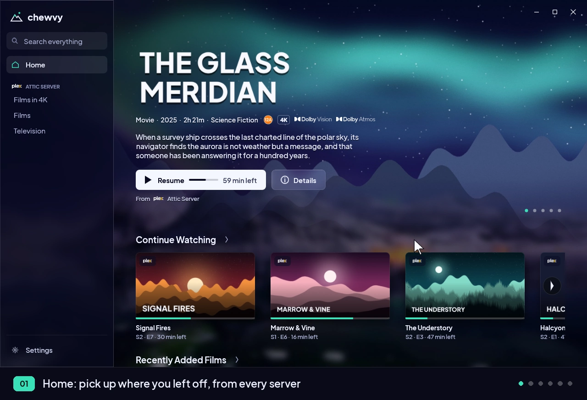
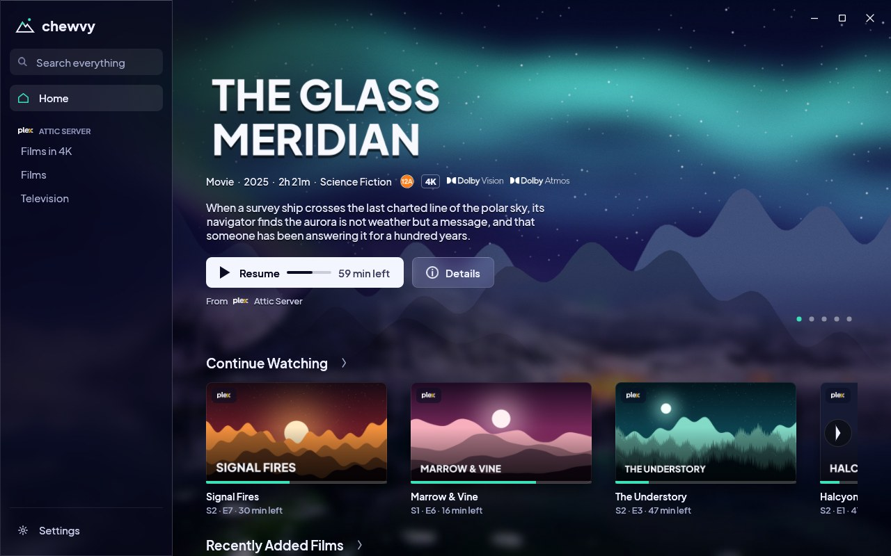
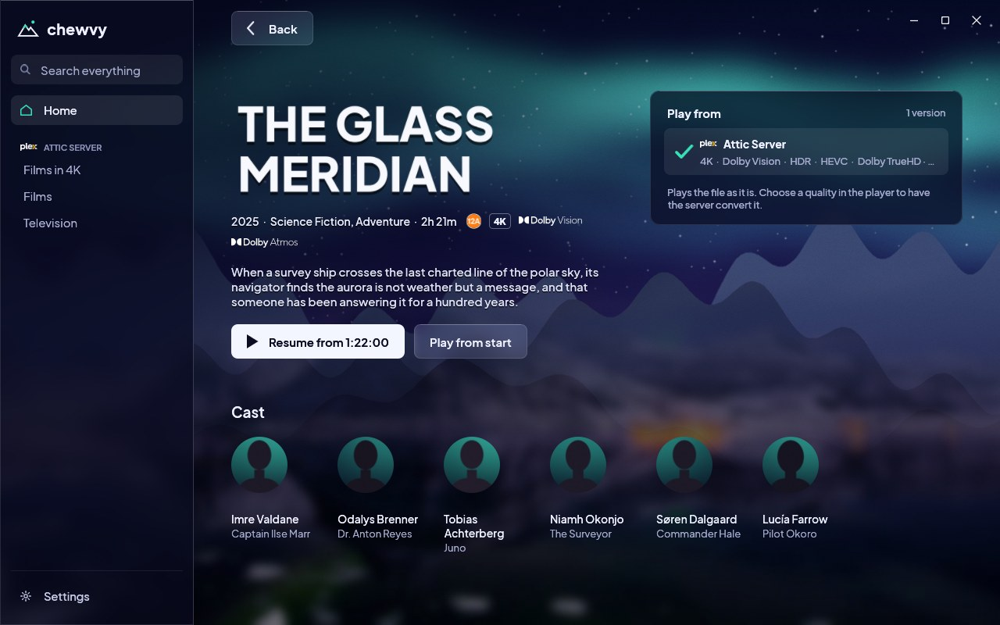
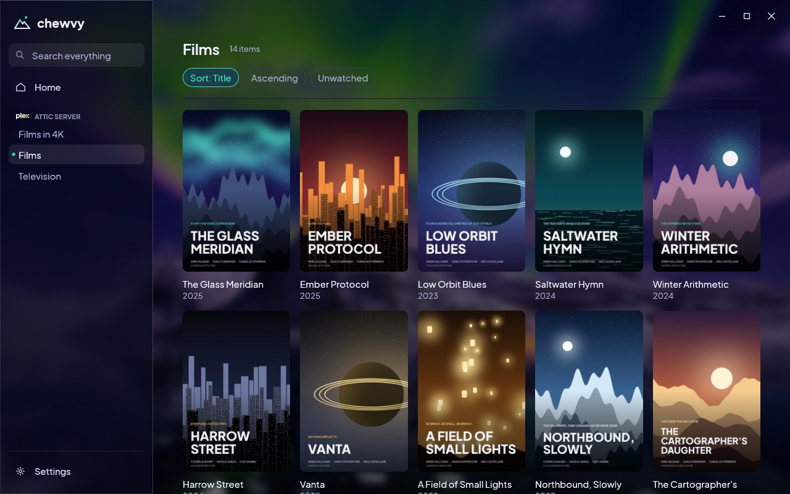
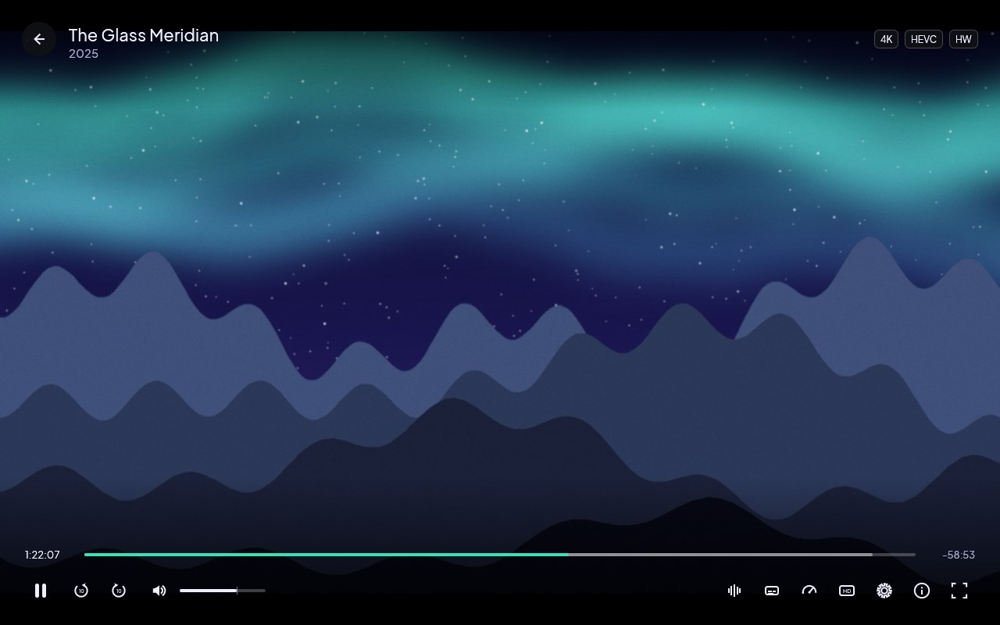
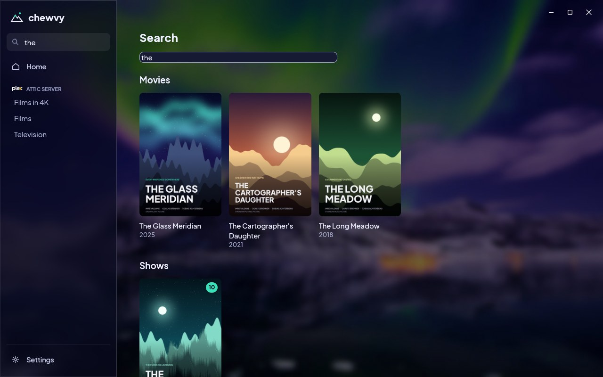
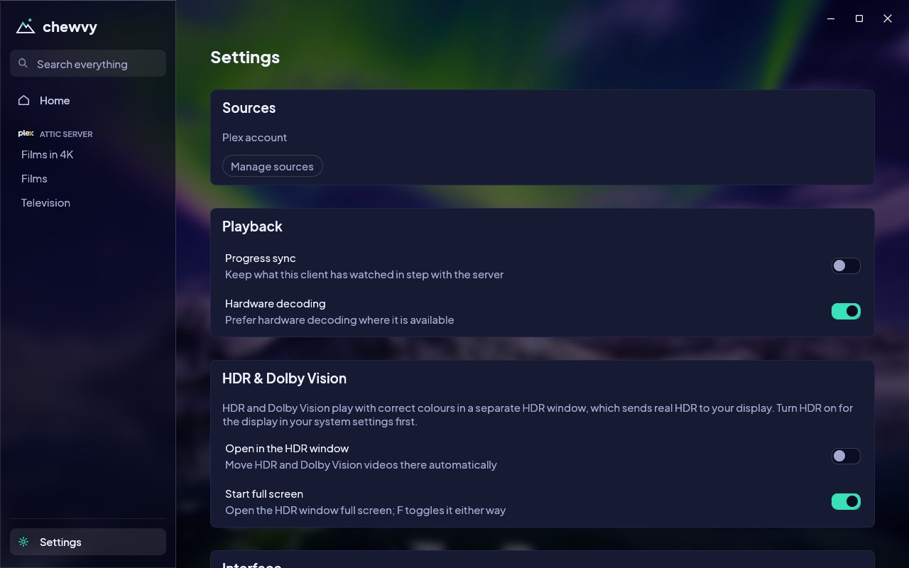

<p align="center">
  
</p>

<h1 align="center">Chewvy</h1>

<p align="center">
  A fast, native desktop client for your Plex and Jellyfin libraries, written in Rust.
</p>

<p align="center">
  
</p>

Chewvy signs in to the media servers you already run, shows their libraries
side by side, and plays through [mpv](https://mpv.io) with hardware decoding.
There is no web view and no Electron: the interface is drawn with
[egui](https://github.com/emilk/egui) straight onto the same OpenGL surface the
video is rendered to.

> Chewvy is an independent project, not affiliated with Plex, Inc. or the
> Jellyfin project. "Plex" and "Jellyfin" name the services it connects to.
> It is free, non-commercial software.

## Features

- **Two kinds of server, one library.** A Plex account and any number of
  Jellyfin servers appear together: one home screen, one sidebar, one search.
- **Sign in without typing a password into the app.** Plex uses the
  `plex.tv/link` code; Jellyfin uses Quick Connect, with a password sign-in to
  your own server as the fallback. Passwords are never stored.
- **Home, libraries, detail pages and search.** Continue Watching, recently
  added shelves, poster grids, seasons and episodes, cast, ratings and format
  badges (4K, HDR10, Dolby Vision, Atmos and so on).
- **mpv playback inside the window.** Hardware decoding where the driver
  offers it, software decoding otherwise; audio and subtitle track selection,
  playback speed, intro and credits skip markers, next episode, a sleep timer.
- **Falls back to the server when a file will not play.** If mpv cannot play
  the original, the item reopens at the same position as a server remux, then
  as a 1080p transcode. The quality menu offers the same choices by hand, with
  presets from 1080p 20 Mbps down to 240p, for Plex and Jellyfin.
- **An HDR window.** HDR10, HLG and Dolby Vision can play in a separate mpv
  `gpu-next` window that sends HDR to the display.
- **Watch progress stays in step with the server**, and can be switched off.
- **Tokens stay in the system keyring** (Secret Service on Linux). They are
  sent as request headers and never appear in a URL or a log line.

## Screenshots

| Home | Detail |
|---|---|
|  |  |

| Library | Player |
|---|---|
|  |  |

| Search | Settings |
|---|---|
|  |  |

These are captures of the running app. The titles, people and artwork in them
are invented for the screenshots.

## Install

Packages are on the [Releases](https://github.com/Ch3w3y/chewvy/releases)
page, each with a SHA-256 in `SHA256SUMS`.

### Linux

```sh
curl -fsSL https://raw.githubusercontent.com/Ch3w3y/chewvy/main/install.sh | sh
```

The script installs for the current user only and never asks for root: the
AppImage goes to `~/.local/bin/chewvy`, with a menu entry and icon under
`~/.local/share`. It checks the download against `SHA256SUMS` before
installing anything. Read it first if you prefer:
[`install.sh`](install.sh).

```sh
sh install.sh --version 0.1.0   # a specific release
sh install.sh --uninstall       # remove everything it installed
```

Or download `Chewvy-<version>-x86_64.AppImage`, make it executable and run it.
The AppImage bundles mpv and FFmpeg; it uses your system's graphics drivers.
Only x86_64 is built, and it needs glibc 2.39 or newer: Ubuntu 24.04, Debian
13, Fedora 40 and current rolling distributions qualify; older releases and
musl-based systems such as Alpine do not.

### Windows

Download `Chewvy-<version>-windows-x86_64-setup.exe` and run it. It installs
for the current user, adds a Start Menu entry and an uninstaller. A portable
`Chewvy-<version>-windows-x86_64.zip` is also provided: unpack it anywhere and
run `chewvy.exe`.

The installer is **not code-signed**, so Windows SmartScreen will warn about
an unrecognised app: choose *More info*, then *Run anyway*. A Vulkan-capable
graphics driver must be installed (the bundled mpv needs `vulkan-1.dll`).

### macOS

Download `Chewvy-<version>-macos-arm64.dmg`, open it and drag Chewvy to
Applications. It needs an Apple Silicon Mac running macOS 15 or newer.

The app is **not notarised by Apple**, so macOS will refuse to open it the
first time. Either allow it under *System Settings > Privacy & Security >
Open Anyway*, or clear the download flag yourself:

```sh
xattr -dr com.apple.quarantine /Applications/Chewvy.app
```

This build is experimental: see the support table below.

## What works where

| Platform | Package | Status |
|---|---|---|
| Linux x86_64 | AppImage, `install.sh` | Developed and used on KDE Plasma (Wayland) with AMD graphics and Mesa. Other desktops, X11 sessions, Intel and NVIDIA graphics are expected to work but have not been measured. |
| Windows 10/11 x86_64 | Installer, zip | Cross-built from Linux. The zip has been started in a Windows 11 virtual machine using software OpenGL, and the installer has only been exercised under Wine; neither has been run on a real GPU, and playback on Windows is untested. The sign-in screen's "Open plex.tv/link" button does nothing on Windows yet: open the address yourself. |
| macOS 15+ (Apple Silicon) | DMG | Experimental. Built on a GitHub-hosted runner, where the app started and drew its window with software OpenGL. **Nobody has run it on a physical Mac**: sign-in, playback and hardware decoding are untested, and "Open plex.tv/link" does nothing there yet. |
| Android, iOS | none | A porting plan only (`docs/MOBILE_PORT.md`). |

### Playback

Chewvy does not claim to play everything. This is what has been measured, on
the Linux development machine (AMD Radeon RX 9070 XT, Mesa VA-API, mpv 0.41):

| Media | Plex | Jellyfin |
|---|---|---|
| H.264 8-bit, HEVC Main/Main10, AV1 and VP9 up to 10-bit, up to 4096x2160, in MKV, MP4, MOV, WebM or a transport stream | Direct play, hardware decoded | Direct play, hardware decoded |
| MPEG-2 up to 1080p, VP8 and MPEG-4 part 2 (in AVI) up to 720p | Direct play, decoded in software; measured with mpv, not from a Plex server | Direct play, decoded in software |
| AAC, MP3, MP2, FLAC, ALAC, AC-3, E-AC-3, DTS core, Dolby TrueHD, 24-bit PCM, Opus, Vorbis audio | Direct play, decoded in software | Direct play, decoded in software |
| Other video codecs (VC-1, WMV, MJPEG, VVC), frames larger than 4096x2160, DTS-HD and other audio families | Handed to mpv as the original file; it may well play, but it is **unmeasured**. If it does not, the fallback below takes over. | Not claimed for direct play: the server sends its own stream (a remux or a transcode) instead. WMV8 was seen playing this way. |
| Fallback when direct play fails | Automatic: server remux, then a 1080p 20 Mbps transcode, then an error naming the last step. Exercised against a mock server only; **not yet against a real Plex Media Server.** | Automatic, the same ladder. Each step was run against a Jellyfin 12.4.0 test server. |
| Server remux or transcode by choice | Quality menu: remux, or presets from 1080p 20 Mbps to 240p | Quality menu, same presets |
| HDR10, HLG, Dolby Vision | Tone-mapped to SDR in the main window; real HDR output and Dolby Vision processing in the separate HDR window. HDR output has not been verified with measuring equipment, and is untested on Windows. | Handled the same way when the item fits the row above, but no HDR item has been played from a Jellyfin server yet. |
| Embedded text subtitles | Rendered by mpv | Rendered by mpv |
| External subtitle files | Loaded and offered as tracks (VobSub skipped) | Not fetched |
| Image-based subtitles (PGS, VobSub) | Untested | Untested |

`docs/CAPABILITIES.md` has the full matrix, how each row was measured, and the
list of things nobody has tried yet.

## Keyboard

| Key | Action |
|---|---|
| Space, K | Play or pause |
| Left / Right, J / L | Seek 10 seconds |
| Up / Down | Volume |
| M | Mute |
| F | Full screen |
| C / A | Next subtitle / audio track |
| [ / ] | Slower / faster |
| S | Skip intro or credits |
| N | Next episode |
| I | Playback information |
| Esc | Leave full screen, or leave the player |

## Build from source

You need Rust 1.99.1 (picked up from `rust-toolchain.toml`), a C toolchain,
`pkg-config`, and the development files for libmpv with client API 2.5 or
newer (mpv 0.40 and later), EGL, Wayland and xkbcommon.

```sh
# Debian 13 (trixie); other distributions need mpv 0.40 or newer
sudo apt install build-essential pkg-config libclang-dev libmpv-dev \
  libegl-dev libgl-dev libwayland-dev libxkbcommon-dev libx11-dev libxcb1-dev

git clone https://github.com/Ch3w3y/chewvy
cd chewvy
cargo build --release --locked -p plex-app
target/release/chewvy
```

`docs/BUILD.md` covers the other distributions, Windows and macOS, the test
gates, and how the packages are made.

## Documentation

- [`docs/BUILD.md`](docs/BUILD.md): building, testing and the gates a change must pass
- [`docs/ARCHITECTURE.md`](docs/ARCHITECTURE.md): crates, threads, rendering and sign-in
- [`docs/CAPABILITIES.md`](docs/CAPABILITIES.md): the tested capability matrix
- [`docs/PACKAGING.md`](docs/PACKAGING.md): AppImage, Windows installer, DMG and releases
- [`docs/PLEX_AUTH.md`](docs/PLEX_AUTH.md), [`docs/JELLYFIN.md`](docs/JELLYFIN.md), [`docs/HARDWARE_DECODE.md`](docs/HARDWARE_DECODE.md): protocol and decoding notes with sources
- [`docs/DEPENDENCIES.md`](docs/DEPENDENCIES.md): every dependency and its licence

## Contributing

Bug reports and pull requests are welcome: see
[`CONTRIBUTING.md`](CONTRIBUTING.md). Security problems go through
[`SECURITY.md`](SECURITY.md), not the public tracker.

## Licence

Chewvy is free software under the [GNU General Public License, version 3 or
later](LICENSE). The packages bundle mpv, FFmpeg and other libraries under
their own licences, and the app includes a photograph, a typeface and service
logos credited in [`THIRD-PARTY-NOTICES.md`](THIRD-PARTY-NOTICES.md).

Plex is a trademark of Plex, Inc. Jellyfin is a trademark of the Jellyfin
project. Dolby, DTS and the other format and rating marks shown in the app
belong to their owners and are used only to label a title's format or rating.
