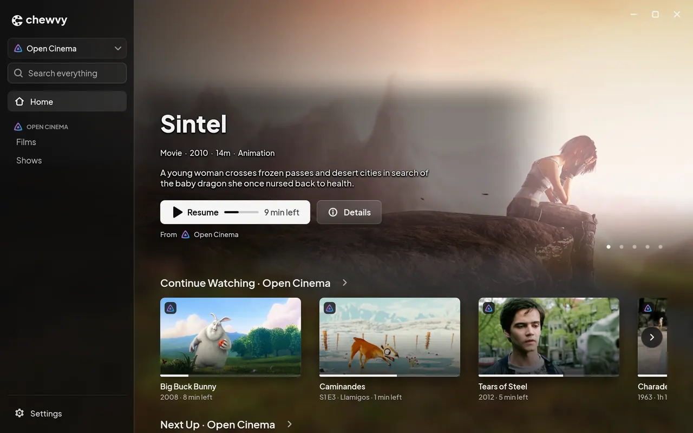
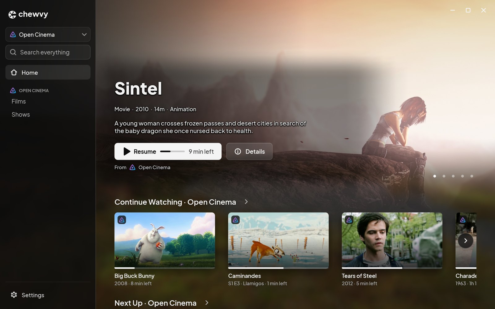
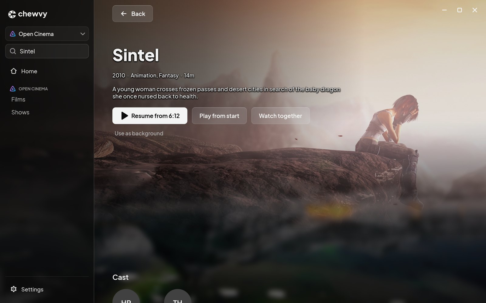
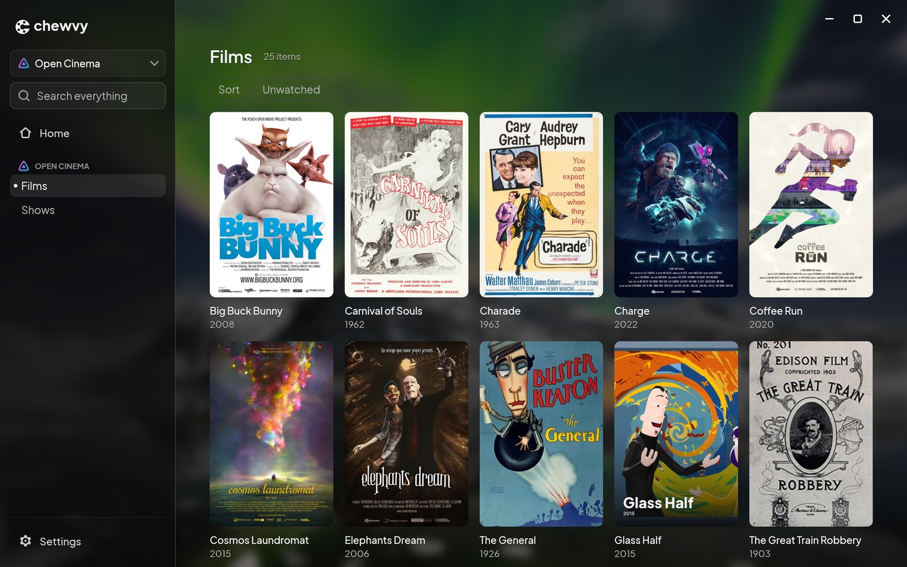

<p align="center">
  
</p>

<h1 align="center">Chewvy</h1>

<p align="center">
  A fast, native desktop client for your Plex and Jellyfin libraries, written in Rust.
</p>

<p align="center">
  <a href="https://ch3w3y.github.io/chewvy/">Website</a> ·
  <a href="https://github.com/Ch3w3y/chewvy/releases/latest">Download</a> ·
  <a href="docs/README.md">Documentation</a> ·
  <a href="CHANGELOG.md">Changelog</a>
</p>

<p align="center">
  
</p>

Chewvy is a fast, native player for the Plex and Jellyfin servers you
already run. Both libraries side by side, true HDR, Watch Together, and every
codec [mpv](https://mpv.io) can play. No Electron, no web view: it is written
in Rust and draws straight onto the same OpenGL surface as the video.

## Features

- **Plex and Jellyfin, together.** A Plex account and any number of Jellyfin
  servers in one home screen, one sidebar and one search. Sign in with a
  `plex.tv/link` code, Jellyfin Quick Connect or a password, which is never
  stored.
- **Watch Together.** Join a SyncPlay group on Jellyfin or a Watch Together
  room on Plex. Play, pause and seek move everyone, including friends on
  Plex's web app.
- **True HDR.** HDR10, HDR10+, HLG and Dolby Vision play in a dedicated HDR
  window that drives your display in real HDR, and are tone-mapped on SDR
  screens.
- **Plays everything.** mpv and FFmpeg decode it, in hardware up to 4K. If a
  file will not play directly, Chewvy has the server remux or transcode it
  and carries on from the same spot. Pick any quality by hand, down to 240p.
- **A proper player.** Audio and subtitle tracks, playback speed, skip intro
  and credits, next episode, sleep timer, and full screen that stays put.
- **Updates itself.** A new release downloads, is checked against its
  checksum, installs and restarts in one click.
- **Private by design.** Chewvy is read-only towards your servers, and sign-in
  tokens live in your system keyring.

## Screenshots

| Home | Film |
|---|---|
|  |  |

| Library | Player |
|---|---|
|  |  |

The films in the screenshots are public domain or Creative Commons; see
[`site/CREDITS.md`](site/CREDITS.md).

## Formats

| | |
|---|---|
| Video | H.264, HEVC, AV1, VP9, VP8, MPEG-2, MPEG-4 Part 2, VC-1, ProRes, MJPEG, WMV |
| HDR | HDR10, HDR10+, HLG, Dolby Vision profiles 5 and 8 |
| Audio | AAC, MP3, FLAC, ALAC, Opus, Vorbis, Dolby Digital and Digital Plus, Dolby TrueHD, DTS, DTS-HD MA, PCM |
| Containers | MKV, MP4, MOV, WebM, AVI, MPEG-TS, WMV/ASF |
| Subtitles | SRT, fully styled ASS/SSA, embedded text tracks, external files from Plex |

[`docs/CAPABILITIES.md`](docs/CAPABILITIES.md) has the details for each
format and platform.

## Install

Packages for Linux, Windows and macOS are on the
[Releases](https://github.com/Ch3w3y/chewvy/releases/latest) page.
[Install Chewvy](docs/INSTALL.md) has the full steps, including updating and
uninstalling.

**Linux** (x86_64; Ubuntu 24.04, Debian 13, Fedora 40 or newer):

```sh
curl -fsSL https://raw.githubusercontent.com/Ch3w3y/chewvy/main/install.sh | sh
```

It installs for your user only, never asks for root, and verifies the
download. Or run the AppImage directly.

**Windows 10 and 11:** run `Chewvy-<version>-windows-x86_64-setup.exe`, or
unpack the portable zip. If SmartScreen asks, choose *More info*, then *Run
anyway*.

**macOS 15 or newer, Apple Silicon:** open the `.dmg` and drag Chewvy to
Applications. On first launch, allow it under *System Settings > Privacy &
Security > Open Anyway*.

## Build from source

```sh
# Debian 13; other distributions need mpv 0.40 or newer
sudo apt install build-essential pkg-config libclang-dev libmpv-dev \
  libegl-dev libgl-dev libwayland-dev libxkbcommon-dev libx11-dev libxcb1-dev

git clone https://github.com/Ch3w3y/chewvy
cd chewvy
cargo build --release --locked -p plex-app
target/release/chewvy
```

[`docs/BUILD.md`](docs/BUILD.md) covers other distributions, Windows and
macOS, and the test gates.

## Documentation

[`docs/README.md`](docs/README.md) is the index: install, keyboard
shortcuts, troubleshooting, FAQ, capabilities, architecture and packaging.

## Contributing

Bug reports and pull requests are welcome: see
[`CONTRIBUTING.md`](CONTRIBUTING.md). Security problems go through
[`SECURITY.md`](SECURITY.md), not the public tracker.

## Licence

Chewvy is free software under the [GNU General Public License, version 3 or
later](LICENSE). The packages bundle mpv, FFmpeg and other libraries under
their own licences; see [`THIRD-PARTY-NOTICES.md`](THIRD-PARTY-NOTICES.md).

Chewvy is an independent project, not affiliated with Plex, Inc. or the
Jellyfin project. Plex, Jellyfin, Dolby, DTS and the other marks belong to
their owners.
