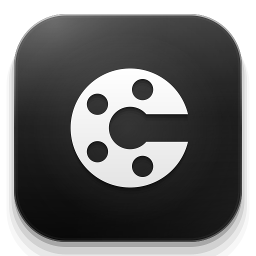
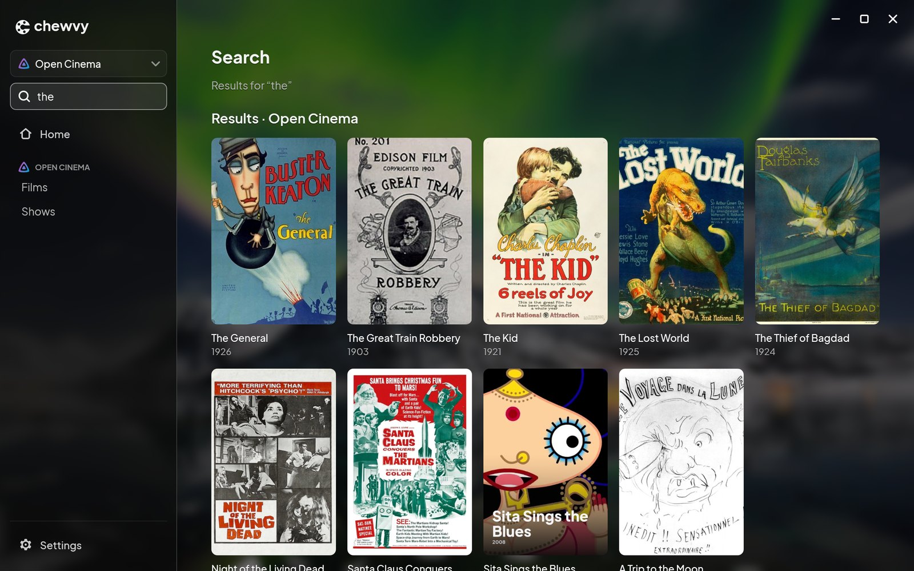
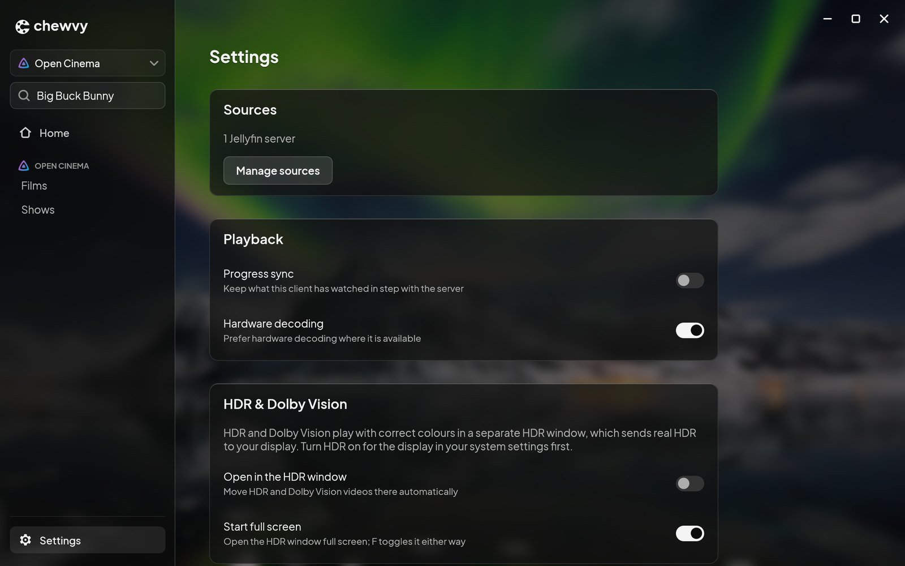
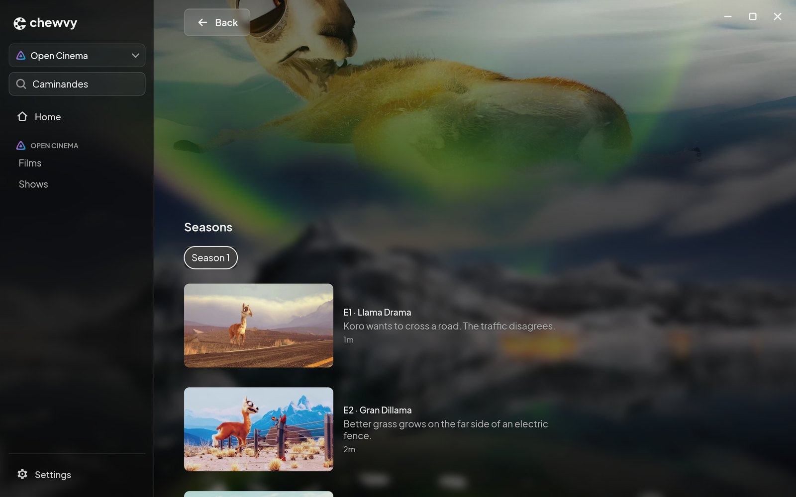
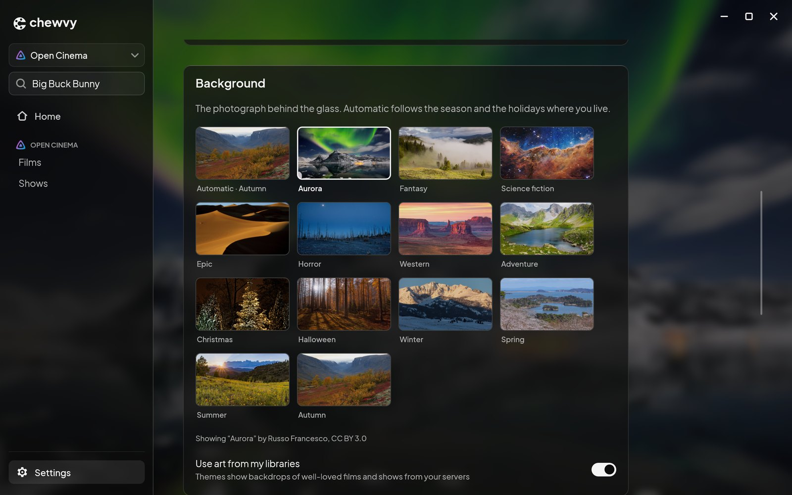
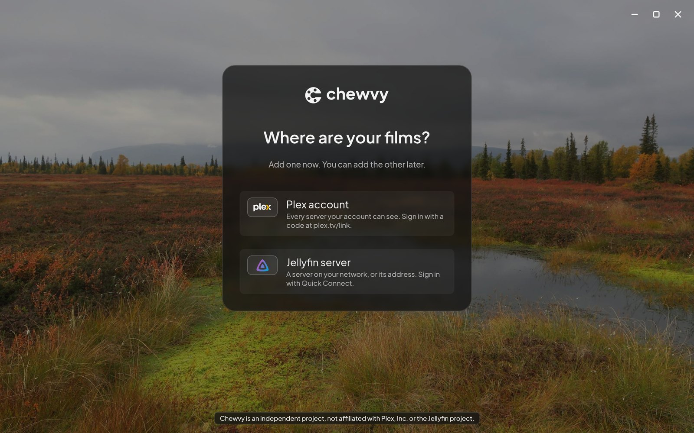
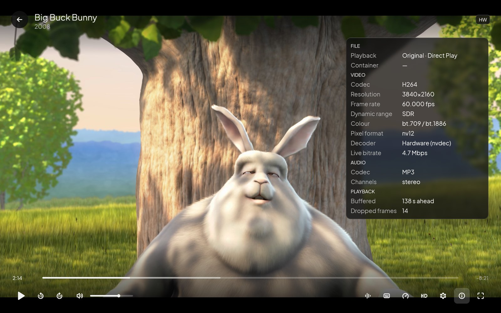

<p align="center">
  
</p>

<h1 align="center">Chewvy</h1>

<p align="center">
  A fast, native desktop client for your Plex and Jellyfin libraries, written in Rust.
</p>

<p align="center">
  <a href="https://ch3w3y.github.io/chewvy/">Website</a> ·
  <a href="https://github.com/Ch3w3y/chewvy/releases/latest">Download</a> ·
  <a href="docs/README.md">Documentation</a> ·
  <a href="CHANGELOG.md">Changelog</a>
</p>

<p align="center">
  
</p>

Chewvy signs in to the media servers you already run, shows their libraries
side by side, and plays through [mpv](https://mpv.io) with hardware decoding.
There is no web view and no Electron. The interface is drawn with
[egui](https://github.com/emilk/egui) onto the same OpenGL surface that the
video is rendered to, as smoked glass over a photograph.

> Chewvy is an independent project, not affiliated with Plex, Inc. or the
> Jellyfin project. "Plex" and "Jellyfin" name the services it connects to.
> It is free, non-commercial software.

## Features

- **Two kinds of server, one library.** A Plex account and any number of
  Jellyfin servers appear together: one home screen, one sidebar, one search.
  Either kind is enough by itself. The first start asks which you have, and
  the switcher at the top of the sidebar lists every server and adds more.
- **Sign in without typing a password into the app.** Plex uses the
  `plex.tv/link` code. Jellyfin uses Quick Connect, with a password sign-in to
  your own server as the fallback. Passwords are never stored.
- **Home, libraries, detail pages and search.** Continue Watching, recently
  added shelves, poster grids, seasons and episodes, cast, ratings and format
  badges such as 4K, HDR10, Dolby Vision and Atmos.
- **mpv playback inside the window.** Hardware decoding where the driver
  offers it, software decoding otherwise. Audio and subtitle track selection,
  playback speed, intro and credits skip markers, next episode, a sleep timer.
- **Falls back to the server when a file will not play.** If mpv cannot play
  the original, the item reopens at the same position as a server remux, then
  as a 1080p transcode. The quality menu offers the same choices by hand, with
  presets from 1080p 20 Mbps down to 240p, for Plex and Jellyfin.
- **An HDR window.** HDR10, HLG, HDR10+ and Dolby Vision can play in a
  separate mpv `gpu-next` window that sends HDR to the display.
- **Watch together.** Start or join a SyncPlay group on Jellyfin, or a
  Watch Together room for a Plex film or episode. A play, pause or seek by
  anyone moves everyone, Plex's web app included.
- **Backgrounds.** The interface is neutral smoked glass over a photograph.
  Settings picks the photograph from Aurora, six genres, two festivals and
  four seasons, or follows the calendar. A theme can also show backdrops from
  your own libraries.
- **Updates from inside the app.** Chewvy says when a release is out,
  downloads the package you installed, checks it against the release's
  `SHA256SUMS`, installs it and restarts.
- **Watch progress can stay in step with the server.** Progress sync is
  off until you turn it on in Settings.
- **Tokens stay in the system keyring** (Secret Service on Linux). They are
  sent as request headers and never appear in a URL or a log line.

## Screenshots

| Home | Film |
|---|---|
|  |  |

| Library | Player |
|---|---|
|  |  |

| Search | Settings |
|---|---|
|  |  |

| Show | Backgrounds |
|---|---|
|  |  |

| First start | Playback information |
|---|---|
|  |  |

These are captures of the running app, made by `site/tools/capture.sh`. The
library in them holds real films that are public domain or Creative Commons.
[`site/CREDITS.md`](site/CREDITS.md) lists each film and image with its source
and licence.

## Install

Packages are on the [Releases](https://github.com/Ch3w3y/chewvy/releases)
page, each with a SHA-256 in `SHA256SUMS`. [Install Chewvy](docs/INSTALL.md)
has the full steps for each platform, including how to check a download,
update and uninstall.

### Linux

```sh
curl -fsSL https://raw.githubusercontent.com/Ch3w3y/chewvy/main/install.sh | sh
```

The script installs for the current user only and never asks for root. The
AppImage goes to `~/.local/bin/chewvy`, with a menu entry and icons under
`~/.local/share`. It checks the download against `SHA256SUMS` before it
installs anything. Read it first if you prefer: [`install.sh`](install.sh).

```sh
sh install.sh --version 0.3.0   # a specific release
sh install.sh --uninstall       # remove everything it installed
```

Or download `Chewvy-<version>-x86_64.AppImage`, make it executable and run it.
The AppImage bundles mpv and FFmpeg, and uses the graphics drivers of your
system. Only x86_64 is built, and it needs glibc 2.39 or newer. Ubuntu 24.04,
Debian 13, Fedora 40 and current rolling distributions qualify. Older
releases and musl-based systems such as Alpine do not.

### Windows

Download `Chewvy-<version>-windows-x86_64-setup.exe` and run it. It installs
for the current user, and adds a Start Menu entry and an uninstaller. A
portable `Chewvy-<version>-windows-x86_64.zip` is also provided: unpack it
anywhere and run `chewvy.exe`.

The installer is **not code-signed**, so Windows SmartScreen warns about an
unrecognised app. Choose *More info*, then *Run anyway*. A graphics driver
with Vulkan support must be installed, because the bundled mpv needs
`vulkan-1.dll`.

### macOS

Download `Chewvy-<version>-macos-arm64.dmg`, open it and drag Chewvy to
Applications. It needs an Apple Silicon Mac that runs macOS 15 or newer.

The app is **not notarised by Apple**, so macOS refuses to open it the first
time. Either allow it under *System Settings > Privacy & Security > Open
Anyway*, or clear the download flag yourself:

```sh
xattr -dr com.apple.quarantine /Applications/Chewvy.app
```

This build is experimental: see the support table below.

## What works where

| Platform | Package | Status |
|---|---|---|
| Linux x86_64 | AppImage, `install.sh` | Developed and used on KDE Plasma (Wayland) with AMD graphics and Mesa. On NVIDIA graphics it has played 4K H.264, VP9 and AV1 with hardware decoding in a headless session only. Other desktops, X11 sessions and Intel graphics are expected to work but have not been measured. |
| Windows 10 and 11, x86_64 | Installer, zip | Cross-built from Linux. Both packages have been installed, started and updated in a Windows 11 virtual machine that draws with software OpenGL, and a Windows build stayed in step with a Linux one in a Watch Together room. Neither package has been run on a real GPU, so hardware decoding and HDR on Windows are untested. |
| macOS 15 or newer, Apple Silicon | DMG | Experimental. Built on a GitHub-hosted runner, where the app started and drew its window with software OpenGL. **Nobody has run it on a physical Mac**: sign-in, playback, hardware decoding and the in-app update are untested there. |
| Android, iOS | none | A porting plan only (`docs/MOBILE_PORT.md`). |

### Playback

Chewvy does not claim to play everything. The table says what has been
measured, on the Linux development machine (AMD Radeon RX 9070 XT, Mesa
VA-API, mpv 0.41):

| Media | Plex | Jellyfin |
|---|---|---|
| H.264 8-bit, HEVC Main/Main10, AV1 and VP9 up to 10-bit, up to 4096x2160, in MKV, MP4, MOV, WebM or a transport stream | Direct play, hardware decoded | Direct play, hardware decoded |
| MPEG-2 up to 1080p, VP8 and MPEG-4 part 2 (in AVI) up to 720p | Direct play, decoded in software; measured with mpv, not from a Plex server | Direct play, decoded in software |
| AAC, MP3, MP2, FLAC, ALAC, AC-3, E-AC-3, DTS core, Dolby TrueHD, 24-bit PCM, Opus, Vorbis audio | Direct play, decoded in software | Direct play, decoded in software |
| Other video codecs (VC-1, WMV, MJPEG, VVC), frames larger than 4096x2160, DTS-HD and other audio families | Handed to mpv as the original file; it may well play, but it is **unmeasured**. If it does not, the fallback below takes over. | Not claimed for direct play: the server sends its own stream (a remux or a transcode) instead. WMV8 was seen playing this way. |
| Fallback when direct play fails | Automatic: server remux, then a 1080p 20 Mbps transcode, then an error naming the last step. Exercised against a mock server only; **not yet against a real Plex Media Server.** | Automatic, the same ladder. Each step was run against a Jellyfin 12.4.0 test server. |
| Server remux or transcode by choice | Quality menu: remux, or presets from 1080p 20 Mbps to 240p | Quality menu, same presets |
| HDR10, HLG, Dolby Vision | Tone-mapped to SDR in the main window; real HDR output and Dolby Vision processing in the separate HDR window. HDR output has not been verified with measuring equipment, and is untested on Windows. | Handled the same way when the item fits the row above. One HDR (PQ) item has been played from a Jellyfin server, tone-mapped in the main window. None has been played in the HDR window. |
| Embedded text subtitles | Rendered by mpv | Rendered by mpv |
| External subtitle files | Loaded and offered as tracks (VobSub skipped) | Not fetched |
| Image-based subtitles (PGS, VobSub) | Untested | Untested |
| Bitstream passthrough to a receiver | Not supported: audio is decoded to PCM | Not supported |

[`docs/CAPABILITIES.md`](docs/CAPABILITIES.md) has the full matrix, how each
row was measured, and the list of things nobody has tried yet.

## Keyboard

| Key | Action |
|---|---|
| Space, K | Play or pause |
| Left / Right, J / L | Seek 10 seconds |
| Up / Down | Volume |
| M | Mute |
| F (player), F11 (anywhere) | Full screen |
| C / A | Next subtitle / audio track |
| [ / ] | Slower / faster |
| S | Skip intro or credits |
| N | Next episode |
| I | Playback information |
| Esc | Leave full screen, or leave the player |
| `/`, Ctrl+K (browsing) | Search |

[Keyboard shortcuts](docs/KEYBOARD.md) lists every key by screen.

## Build from source

You need Rust 1.99.1 (picked up from `rust-toolchain.toml`), a C toolchain,
`pkg-config`, and the development files for libmpv with client API 2.5 or
newer (mpv 0.40 and later), EGL, Wayland and xkbcommon.

```sh
# Debian 13 (trixie); other distributions need mpv 0.40 or newer
sudo apt install build-essential pkg-config libclang-dev libmpv-dev \
  libegl-dev libgl-dev libwayland-dev libxkbcommon-dev libx11-dev libxcb1-dev

git clone https://github.com/Ch3w3y/chewvy
cd chewvy
cargo build --release --locked -p plex-app
target/release/chewvy
```

[`docs/BUILD.md`](docs/BUILD.md) covers the other distributions, Windows and
macOS, the test gates, and how the packages are made.

## Documentation

[`docs/README.md`](docs/README.md) is the index. The pages people ask for
most:

- [Install Chewvy](docs/INSTALL.md): install, check, update and remove it
- [Troubleshooting](docs/TROUBLESHOOTING.md): when it will not start, sign in or play
- [Questions and answers](docs/FAQ.md): cost, privacy, formats, platforms
- [Capability matrix](docs/CAPABILITIES.md): what has been measured, and where
- [Building and testing](docs/BUILD.md) and [Architecture](docs/ARCHITECTURE.md): for contributors
- [Packaging and releases](docs/PACKAGING.md): AppImage, Windows installer, DMG

## Contributing

Bug reports and pull requests are welcome: see
[`CONTRIBUTING.md`](CONTRIBUTING.md). Security problems go through
[`SECURITY.md`](SECURITY.md), not the public tracker.

## Licence

Chewvy is free software under the [GNU General Public License, version 3 or
later](LICENSE). The packages bundle mpv, FFmpeg and other libraries under
their own licences, and the app includes photographs, a typeface and service
logos credited in [`THIRD-PARTY-NOTICES.md`](THIRD-PARTY-NOTICES.md).

Plex is a trademark of Plex, Inc. Jellyfin is a trademark of the Jellyfin
project. Dolby, DTS and the other format and rating marks shown in the app
belong to their owners and are used only to label a title's format or rating.
